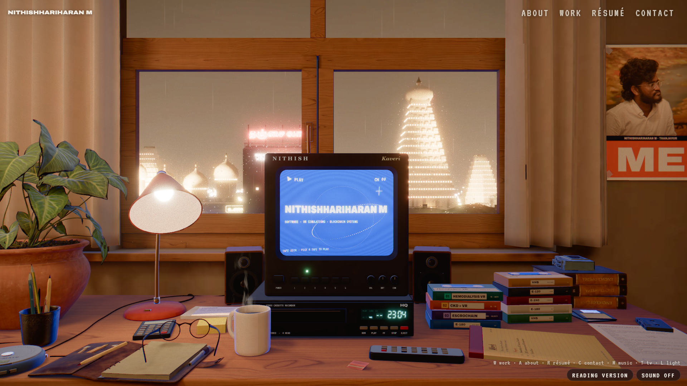
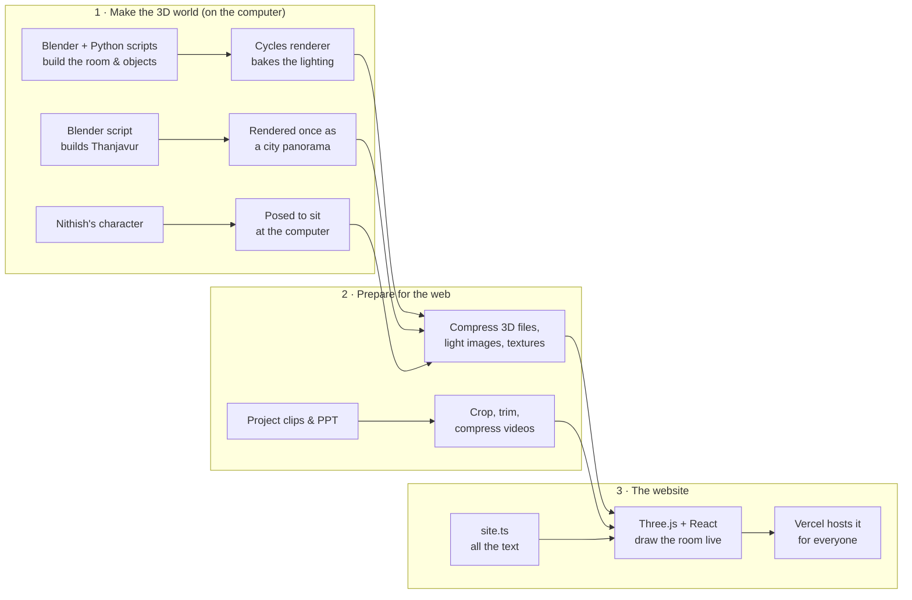

# How the Night Desk portfolio was made

A plain-language guide to **Nithishhariharan M's 3D portfolio**: what it is, how every part
was built, and which technologies do what. No programming knowledge needed.

**Live site:** https://nithoroom-portfolio.vercel.app

---

## Contents

1. [What this is, in one minute](#1-what-this-is-in-one-minute)
2. [It is a live 3D room, not a picture](#2-it-is-a-live-3d-room-not-a-picture)
3. [The big picture](#3-the-big-picture)
4. [How it was made, step by step](#4-how-it-was-made-step-by-step)
5. [Technologies and what each one does](#5-technologies-and-what-each-one-does)
6. [Where everything lives](#6-where-everything-lives)
7. [How to change things](#7-how-to-change-things)
8. [Words explained](#8-words-explained)
9. [By the numbers](#9-by-the-numbers)
10. [What was kept private, and why](#10-what-was-kept-private-and-why)
11. [Who made what](#11-who-made-what)

---

## 1. What this is, in one minute

The portfolio is a cosy desk in a room on the fifth floor in Thanjavur, on a rainy night.
Through the window you can see the floodlit Big Temple, gopurams, the palace domes and
Tamil neon shop signs. Everything on the desk does something:

| On the desk | What it does |
| --- | --- |
| **Video tapes** | Each tape is one project. Click it and it flies into the VCR, the TV shows static, then the project's real footage plays. |
| **Yellow legal pad** | The "Work" list. It lifts up and shows what Nithish did on the selected project. |
| **Old computer** (with Nithish's own 3D character sitting at it) | The "About" section, shown as green terminal text. |
| **Printed sheet** | The résumé. It can be downloaded or opened as a PDF. |
| **Index card** | Contact links (GitHub, email, résumé). |
| **Discman + two speakers** | Music. Clicking the Discman starts it; the sound comes out of the speakers. |
| **"ME" poster** | Nithish's photo on the wall. |
| **Wall switch** (above the computer) | Turns the room's tube light on and off. The tube blinks a couple of times before it stays on, like a real one. |
| **Desk lamp** | Click it to switch it off and on. |

The room also has small signs of life: steam rising from the coffee, dust drifting in the
lamp light, curtains and plant leaves moving slightly, twinkling fairy lights, and now and
then lightning over the city (with thunder if the sound is on).

The top menu (About · Work · Résumé · Contact), the keyboard and the browser's Back button
all work too, and there is a plain **reading version** for anyone who prefers a normal page.

---

## 2. It is a live 3D room, not a picture

This is the most common question, so first: **no AI image generator was used.** The room
is a real 3D scene that the browser draws live, around 60 times every second. That is why
the camera can glide around, tapes can move and the TV can play video.

| What you see | How it is really made |
| --- | --- |
| The desk, TV, lamp, tapes, room | 3D models built by **code** in Blender, drawn live by the browser |
| Soft, warm lighting and shadows | Light calculated once in Blender and saved into images ("baked"), then laid back onto the models. Each group of lights has its own images, so lights can be switched on the website |
| The city outside | A separate 3D city, rendered once into a wide panoramic picture; the window glass adds rain on top |
| TV screen, notepad, computer text, labels | Drawn live by the website from the text in one content file |
| Project videos on the TV | Nithish's own screen recordings, cropped and compressed |
| Nithish's character | Nithish's own 3D model, posed by a script to sit on the chair |
| Music and rain | Generated by code in the browser and played from the 3D speakers |

The only ready-made pictures are the city panorama, the baked light images, and the still
image used while the page loads.

---

## 3. The big picture

---

## 4. How it was made, step by step

### Step 1 — Studying the reference and planning

The design follows the idea of [felixrieseberg.com](https://felixrieseberg.com/) (a desk at
night with a VCR and tapes). Its look, camera moves and timing were studied from the live
site and a screen recording. **Only the idea was borrowed**: every model, texture, line of
code and piece of text here is new or free to use.

The written brief set the rules: a fresh project, real 3D, Nithish's real details only
(nothing invented), clear placeholders where information was missing, and it must work
with a keyboard, on phones and on slow computers.

### Step 2 — Building the room in Blender, with code

[Blender](https://www.blender.org/) is free 3D software. Instead of modelling by hand,
Python scripts tell Blender exactly what to build (`blender/build_scene.py`). Each object is
made from simple shapes (boxes, cylinders, shapes spun around an axis) with real sizes in
metres, so everything has a believable scale: the desk is 76 cm high, the TV screen about
30 cm wide.

Built this way: the room, window, frames and curtains, desk and drawer, the CRT TV, the VCR
with its buttons and clock display, the tape stacks, legal pad, desk lamp, mug, Discman and
headphones, the old computer and keyboard, side desk, wardrobe, poster, two walnut
speakers (with woofer, tweeter and power light), the teak chair, the fairy lights, an
Indian-style switchboard above the computer (one of its rockers is a separate piece so it
can flip) and a wall-mounted tube light.

Each object also gets a **material** (wood, plastic, metal, paper, glass) that says how it
looks and reflects light.

### Step 3 — Free props and textures

Some objects came ready-made from [Poly Haven](https://polyhaven.com/), a free library whose
assets are **CC0** (free for any use, no credit required): the potted plant, round glasses,
pens and pencils, notepads, the leather folio, a cassette player, books and postcards. The
wood, wall, curtain, floor-tile textures also come from there. A script downloads them
(`scripts/fetch-polyhaven.mjs`).

### Step 4 — Baking the light

Realistic light (the lamp's warm glow, soft shadows, light bouncing off walls) is too slow to
calculate live in a browser. So it is calculated **once** in Blender with its **Cycles**
renderer, which traces how light rays bounce around the room. The result is saved into
"lightmap" images for three groups of objects (room, desk, props). On the website these
images are laid back onto the objects, so the room looks rendered but runs fast.
(`blender/bake_export.py`)

To make lights switchable, the lights are baked **in four separate layers**, each into its
own set of images:

| Layer | Lights in it | On the website |
| --- | --- | --- |
| base | two room lights, a corner light over the computer, a warm wash behind the fairy lights, small LEDs | always on |
| window | the cool night light through the glass and the sky | brightened for a moment by lightning |
| lamp | the desk-lamp bulb and its glowing shade | the lamp click switches it |
| tube | the tube light on the wall | the wall switch turns it on |

The website adds the layers together for every pixel, each with its own strength. Light
simply adds up in real life too, so the sum looks exactly like one complete bake, and
turning a layer up or down relights the whole room, including the light bouncing off the
walls and the soft shadows. Nithish's seated character is included in the bake so the
character's shadow falls on the chair and desk.

### Step 5 — Building Thanjavur outside the window

A second script (`blender/build_city.py`) builds a whole little city, modelled after a
reference image:

- the **Big Temple vimana** (13 stepped tiers with small shrines, the dome and the golden
  kalasam) with floodlights and string lights,
- two **gopurams**, a **palace with onion domes**, and a lodge with rooftop letters
  "தஞ்சை லாட்ஜ் / THANJAI LODGE",
- two- and three-storey shop rows with balustrades, black rooftop water tanks, coconut palms,
  banana plants, sodium street lamps, power lines, yellow autos, a bus and motorbikes,
- warm, hazy monsoon air.

The shop signs are in Tamil and English (generic shop names, not real brands). Blender
cannot shape Tamil letters correctly, so the signs are first **drawn in the Chrome browser**
as images (`scripts/make-signs.mjs`) and then placed in the city as glowing panels.

The city is rendered **once** as a wide panoramic image (4096 pixels across). On the website,
the window glass shows this image and adds moving raindrops, streaks, reflections of the room
and a slight depth shift when the camera moves.

### Step 6 — Preparing the files for the web

Raw 3D files are big. Two steps make them small enough for a website:

- **Export** from Blender as a GLB file (one file containing all the 3D objects).
- **Compress** (`scripts/optimize-assets.mjs`): textures become WebP images, geometry is
  squeezed with meshopt, light images become WebP. The room goes from about 31 MB to 5.6 MB.

### Step 7 — The website itself

The website is built with **React** (for the page and buttons) and **Three.js** (for 3D),
connected by **React Three Fiber**.

- **Camera "shots".** Each section has a saved camera position (`src/scene/shots.json`):
  overview, work, TV, about, résumé, music, contact, plus separate ones for phones. The
  camera glides smoothly between them, and if you click something else mid-move it turns
  smoothly instead of jumping.
- **Clicking things in 3D.** The site checks which object is under the mouse (raycasting),
  shows a small label such as "PLAY · ESCROCHAIN", and reacts on click.
- **The tape machine.** A tape lifts from the stack, flies to the VCR, slides in, the TV shows
  static, then the programme plays. Choosing another tape ejects the first one onto the
  desk. Fast repeated clicks never break it (this was tested automatically).
- **Web addresses.** Each view has its own link (for example `#/work/escrochain`), so the
  browser's Back button and shared links work.
- **Hidden HTML twins.** Everything you can read or press in 3D has an invisible web element
  glued exactly on top of it. That is what makes keyboard navigation, screen readers and
  real links work.

### Step 8 — Screens drawn live from one content file

All the words in the room come from **one file**: `src/content/site.ts`. From it, the website
draws (using the browser's canvas):

- the **TV**: loading bar, "enter with / without sound", the title card, static, each tape's
  title card and video, subtitles,
- the **legal pad**, in a handwriting font,
- the **computer terminal**, green text that scrolls,
- the **résumé printout**, the **contact card**, the **tape labels**, the VCR's clock, and
  the **"ME" poster**.

Change the text in that file and every screen updates.

### Step 9 — Nithish's project material

- **Résumé PDF** → name, summary, skills, education, the Hemodialysis VR and EscroChain
  descriptions, GitHub and email.
- **Project presentation (PPT)** → the CKD project: the summary, Nithish's own modules
  (data preparation, the logistic-regression model, ONNX conversion, Unity Sentis
  integration), the results, and credit to teammate Navena RK. Four slides became pictures.
- **Screen recordings** → `scripts/encode-media.mjs` crops away the Unity editor panels,
  browser tabs and taskbar, trims the start and end, compresses the videos for the web, and
  saves a "poster" frame for each.

Nothing was invented. Where information was missing (for example dates for two projects),
it was left empty rather than guessed.

### Step 10 — Nithish's 3D character

The character model (`nitho_articulation_v2`) has a skeleton of 60 bones. A script
(`blender/pose_character.py`) bends each bone into a seated pose (stored in
`blender/nitho_pose.json`) and places the character on the teak chair at the old computer,
reading the screen. The hands rest in the lap, where the About camera does not see them
(hands on the keyboard looked unnatural up close); the phone framing of the About view was
raised a little for the same reason.

On the website the character:

- **blinks** every few seconds (eyelid shape keys),
- **breathes** slowly (the chest bone moves slightly),
- moves the **head** a tiny bit,
- is lit by a **light probe**: a 360° snapshot of the corner where the chair stands, so the
  lighting matches the baked room (and follows the lamp and the tube light when they are
  switched).

The character loads after the room is ready, so it never slows down the first view.

### Step 11 — Sound and music

All sound uses the browser's **Web Audio** engine:

- **Rain, room tone, tape and button sounds** are generated by code. Nothing is recorded.
  So are the click of the wall switch and the lamp, the tube light's "tink" as it starts
  and its faint hum, and the thunder that rolls in a second or two after lightning.
- **Music**: the Discman plays three lo-fi loops that are *composed by code* in the browser
  (electric piano, bass, soft drums, vinyl hiss), so there are no copyright worries.
- **From the speakers**: the left and right channels are placed at the two speakers in 3D
  (positional "HRTF" sound) and the listener moves with the camera, so the music really
  comes from the desk and shifts as you look around. The speaker cones pump to the beat and
  their lights glow.
- Sound is **off** until the visitor chooses "enter with sound" or presses play.

### Step 12 — The finishing look

- A **CRT effect** for the TV and computer: curved glass, scan lines, colour fringes, static.
- **Screen effects** over the whole view: soft glow (bloom), a little film grain, slight
  colour fringing and a vignette (darker edges), like a camera.
- Small details: rain streaks, the VCR clock, the lamp's real-time light on moving objects.
- **Signs of life**, each a small shader on the graphics card:
  - steam curling up from the coffee (moving noise on a see-through card),
  - dust drifting and glinting in the lamp's light (it disappears when the lamp is off),
  - the curtains and the plant's leaves swaying a few millimetres, as if from a ceiling fan,
  - the fairy-light bulbs twinkling one by one,
  - lightning: the sky in the window flashes and the room lights up from the window
    side for a fraction of a second.

### Step 13 — Making it work for everyone

- **Reading version** (`?reading` at the end of the address): a simple page with everything,
  including the videos. It opens automatically if a browser cannot show 3D.
- **Keyboard**: Tab moves between objects (with visible focus rings), including the desk
  lamp and the wall switch; W, A, R, C, M, T open sections; L switches the room light;
  Esc goes back. Screen readers hear "Room light on" and similar messages.
- **Reduced motion**: if the visitor's system asks for less movement, the camera cuts
  instead of gliding, the tube light fades in without blinking, there is no lightning, and
  the steam, dust, curtains and fairy lights hold still.
- **Flashing**: the tube blinks at most twice and lightning is two quick pulses that come
  rarely, below the "three flashes a second" safety limit.
- **Slow computers**: if frames get slow, a lighter mode switches on automatically.
- **Graphics crash**: if the graphics driver resets, a friendly message offers to reload or
  switch to the reading version.
- **Phones**: separate camera framings for tall screens and finger-sized buttons.

### Step 14 — Testing

**Playwright** controls a real Google Chrome automatically:

- takes the **screenshots** in `docs/screenshots/` (desktop and phone),
- runs a **stress test** that clicks tapes and views very quickly, then checks everything
  ends up in a correct state,
- checks hover labels, keyboard focus, the reading version, the "no 3D" fallback, the
  graphics-crash message and the slow-computer mode,
- records the **demo video** (`docs/demo/demo.mp4`) frame by frame with a fake clock, so the
  video stays smooth even if the computer is busy, then FFmpeg turns the frames into MP4.

### Step 15 — Publishing

- **GitHub** stores the code: https://github.com/nithish008888/NithoRoom-portfolio
- **Vercel** builds it (`npm run build`) and hosts it: https://nithoroom-portfolio.vercel.app

---

## 5. Technologies and what each one does

### The website

| Technology | What it is | What it does here |
| --- | --- | --- |
| **TypeScript** | JavaScript with built-in error checking | All of the website's code |
| **React 19** | A library for building pages from reusable pieces ("components") | The menu, buttons, panels, overlays and the reading version |
| **Three.js** | The most popular 3D library for the web (uses WebGL) | Draws the room, lights, materials and camera |
| **React Three Fiber** | Lets React control Three.js | Each part of the room (tapes, notepad, speakers, character) is a component |
| **postprocessing** (+ its React version) | Screen effects for Three.js | Glow, film grain, vignette, colour |
| **WebGL 2 + GLSL shaders** | Small programs that run on the graphics card | Rainy window glass, CRT screens, baked-light materials |
| **Canvas 2D** | The browser's drawing surface | TV, notepad, terminal, résumé, labels, poster |
| **Web Audio API** | The browser's sound engine | Music, positional speakers, rain and sound effects |
| **zustand** | A tiny way to share "state" between parts of the app | Current view, which tape is playing, music status |
| **Vite** | A fast development server and build tool | Runs the site locally (port 4810) and builds the final files |
| **Fontsource** | Free fonts packaged for websites | Archivo (titles), Caveat (handwriting), VT323 (TV and terminal), Courier Prime (résumé), Catamaran (Tamil) |

### Making the 3D world

| Technology | What it is | What it does here |
| --- | --- | --- |
| **Blender 5.2** | Free 3D modelling and rendering software | Builds the room and the city, poses the character |
| **Python** | A programming language that can control Blender | Every model, light and city building is created by a script |
| **Cycles (with NVIDIA OptiX)** | Blender's realistic renderer, using the graphics card | Bakes the lighting and renders the city panorama |
| **glTF / GLB** | The standard file format for 3D on the web | The exported room and character |
| **Poly Haven** | A library of free (CC0) 3D models and textures | Plant, glasses, stationery, books, wood/wall/floor textures |

### Preparing files

| Technology | What it is | What it does here |
| --- | --- | --- |
| **Node.js** | Runs JavaScript on the computer (outside the browser) | Runs all the helper scripts |
| **glTF-Transform** | A toolkit for editing glTF files | Cleans and compresses the 3D files |
| **meshoptimizer** | Geometry compression | Makes the 3D files much smaller |
| **sharp** | Image processing | WebP textures, light images, stills, the poster photo |
| **FFmpeg** | The standard video tool | Crops and compresses the project clips; builds the demo video |

### Testing and publishing

| Technology | What it is | What it does here |
| --- | --- | --- |
| **Playwright + Google Chrome** | Browser automation | Screenshots, stress tests, the demo video |
| **Git + GitHub** | Version history and code hosting | Stores the project online |
| **Vercel** | Website hosting | Builds and serves the live site |

---

## 6. Where everything lives

| Folder / file | What is inside |
| --- | --- |
| `src/content/site.ts` | **All the text**: bio, projects, videos, contact, music, decorations |
| `src/scene/` | The 3D room on the website: room, tapes, notepad, speakers, character, camera, effects, the switchable lights (`lighting.ts`, `LightControls.tsx`) and the steam and dust (`Ambience.tsx`) |
| `src/scene/screens/` | Drawing code for the TV, notepad, terminal, résumé, contact card, labels, poster |
| `src/scene/materials/` | Shaders: the rainy window, the CRT screen, the baked light |
| `src/ui/` | The menu, buttons, loading screen, music panel and the HTML twins |
| `src/audio/` | Sound: rain and effects, music player, positional speakers |
| `src/reading/` | The plain reading version |
| `public/` | Files the website serves: 3D models, light images, city image, videos, résumé PDF, photos |
| `blender/` | The Blender scripts that build the room, the city and the character pose |
| `scripts/` | Helper scripts: download props, make signs, prepare videos, compress files, screenshots, tests, demo |
| `docs/` | Screenshots and the demo video |
| `project-guide/` | This guide |

---

## 7. How to change things

| You want to… | Do this |
| --- | --- |
| Change any text (bio, a project, contact) | Edit `src/content/site.ts`. Every screen updates. |
| Add a project video or screenshots | Put the files in `public/media/<project-id>/` and list them under that project's `media` in `site.ts`. |
| Use your own music | Put the file in `public/audio/` and add it to `music.tracks` in `site.ts` (only music you have the rights to publish). |
| Change the poster photo | Replace `public/images/me.jpg`. |
| See your changes | Run `npm run dev` and open http://127.0.0.1:4810 |
| Publish your changes | Push to GitHub, then deploy on Vercel. |
| Rebuild the 3D room or city | See the commands in the main `README.md` (needs Blender). |

---

## 8. Words explained

| Word | Meaning |
| --- | --- |
| **3D model / mesh** | An object made of many small flat triangles |
| **Texture** | A picture wrapped around a model (wood grain, wall paint) |
| **Material** | The settings that say how a surface looks: colour, shine, roughness |
| **Rendering** | Turning a 3D scene into a picture. "Real-time" means many times per second, live |
| **Baking / lightmap** | Calculating the lighting once and saving it into an image, so the browser doesn't have to |
| **Light layer** | One group of lights baked on its own, so the website can turn it up, down or off |
| **Path tracing** | A realistic way to render: following light rays as they bounce around |
| **Panorama** | A very wide picture that wraps around the viewer |
| **Shader** | A small program on the graphics card that decides the colour of each pixel |
| **GLB** | A single file that holds 3D models, materials and textures |
| **WebP** | A modern image format: small files, good quality |
| **Raycasting** | Working out which 3D object is under the mouse pointer |
| **Bones / rig** | The invisible skeleton inside a character that bends its body |
| **Shape key** | A saved face shape (like closed eyelids) that can be blended in, used for blinking |
| **Light probe** | A 360° snapshot of a spot in the room, used to light the character realistically |
| **Positional (HRTF) audio** | Sound that seems to come from a place in space, like the speakers |
| **CC0** | "No rights reserved": free to use for anything |
| **Deploy** | Put the finished website online |

---

## 9. By the numbers

| | |
| --- | --- |
| Projects on tapes | 3 (each with its own video; 6 extra pictures) |
| Room scene in Blender | 383 objects, about 176,000 triangles |
| Light images (lightmaps) | 12 (4 light layers × 3 object groups), 1024 or 2048 pixels square, baked in about 8 minutes, 2.2 MB on the web |
| City panorama | 4096 × 2457 pixels, rendered in about 9 minutes |
| Nithish's character | about 102,000 triangles, 60 bones, 1.4 MB on the web |
| 3D room file for the web | 5.6 MB (from about 31 MB) |
| Whole website | about 29 MB; the first view downloads about 9 MB, videos only load when a tape plays |
| Screenshots / demo | 26 screenshots, a 67-second demo video |

---

## 10. What was kept private, and why

The GitHub repository is public, so some source material stays only on Nithish's computer
(the `assets-src/` folder is not uploaded):

- the **original screen recordings**: one showed a browser tab with someone's email address
  and a Windows username. Only the cleaned, cropped versions are published.
- the **project presentation**: it contains classmates' and the guide's details.
- the **original photo, character file and Blender working files**.
- a **commercial song** that was supplied: publishing someone else's song on a website needs
  the rights holder's permission, so the site plays code-generated music instead.

---

## 11. Who made what

- **Brief, content and personal material** (résumé, project presentation, recordings,
  photo, 3D character, Thanjavur reference): Nithishhariharan M.
- **Design, 3D building scripts, website code, testing and publishing**: written by Claude,
  an AI coding assistant, working in this project folder from Nithish's brief.
- **Free props and textures**: Poly Haven (CC0). **Fonts**: Archivo, Caveat, VT323, Courier
  Prime, Catamaran (SIL Open Font License, via Fontsource).
- **Design inspiration**: felixrieseberg.com (the idea only; nothing copied).
